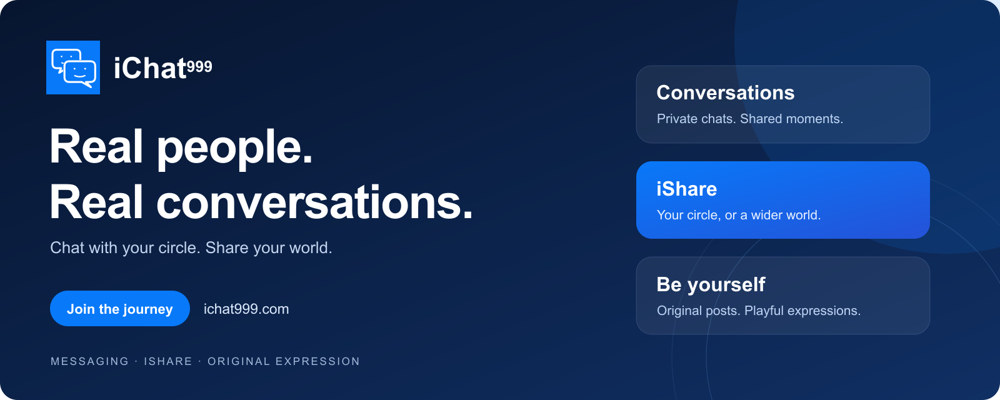
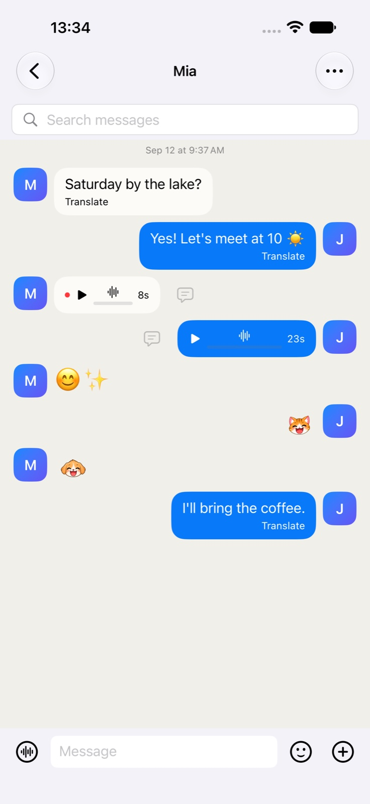
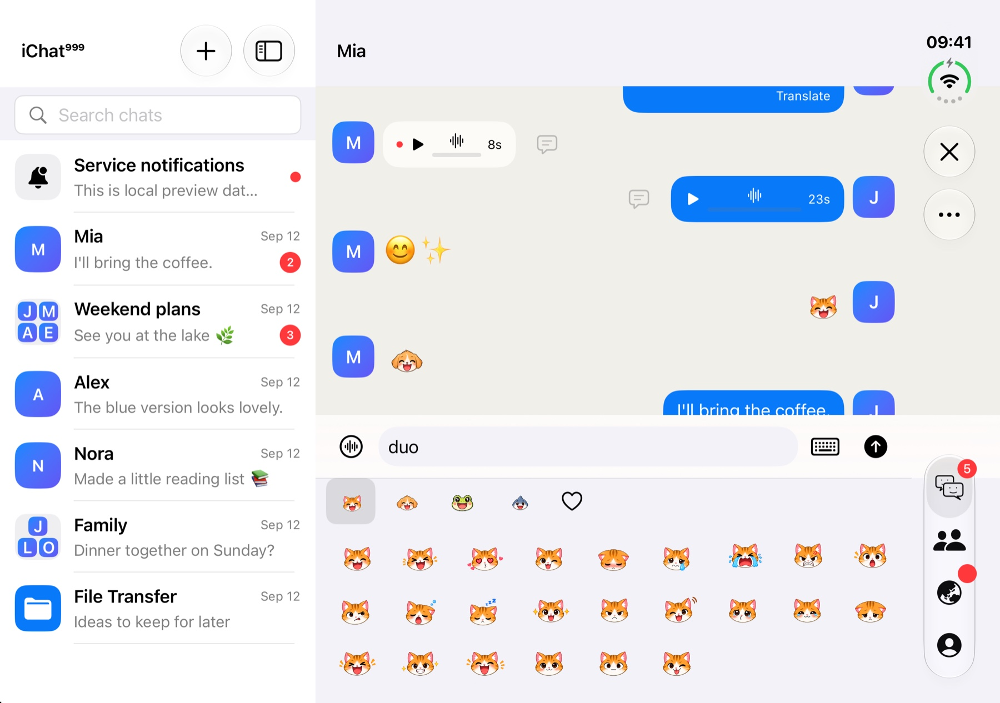

  <a href="https://ichat999.com/#download"><strong>Get a test build</strong></a> &nbsp; · &nbsp;
  <a href="https://ichat999.com/#screenshots">Explore the app</a> &nbsp; · &nbsp;
  <a href="https://github.com/ichat999-2026/iChat999-Downloads/issues">Join the testing community</a>

## A little closer to your people

Private and group conversations. Personal and public iShare. Original expressions that make a message yours.

<table>
  <tr><th width="32%">Conversations, your way</th><th width="68%">Room to connect</th></tr>
  <tr>
    <td align="center"></td>
    <td align="center"></td>
  </tr>
  <tr><td align="center">Text, voice and playful expression.</td><td align="center">An expanded layout for your conversations.</td></tr>
</table>

App-rendered simulator previews with fictional sample data, captured October 7–9, 2026. Not real-device or latest-build acceptance evidence. Features vary by platform and build. Click an image to view it in full. <a href="ASSETS.md">Image details</a>.

## Try iChat999

| Platform | Available now |
| --- | --- |
| Android | [Website test APK · 1.0.1 (32)](https://github.com/ichat999-2026/iChat999-Downloads/releases/download/website-test-1.0.1-b32-20261017/iChat999-Android-20261017-v1.0.1-build32-Website-Test.apk). Top-ups unavailable; a pre-release test, not a Google Play release. |
| Windows | [Offline UI preview · 1.0.1 (32)](https://github.com/ichat999-2026/iChat999-Downloads/releases/download/website-test-1.0.1-b32-20261017/iChat999-Windows-Preview-1.0.1-b32-20261017-033309-x64-setup-unsigned.exe). Unsigned, x64; no sign-in, live messaging, media or payments. |
| Mac | Website test installer awaiting notarization. [Check availability](https://ichat999.com/#download). |
| iPhone & iPad | App Store release preparation. [Follow availability](https://ichat999.com/#download). |

[Release files & checksums](https://github.com/ichat999-2026/iChat999-Downloads/releases/tag/website-test-1.0.1-b32-20261017) · [Installation guide](INSTALL.md) · [What changed](RELEASE-NOTES.md)

## Help shape what comes next

We welcome real usage and honest feedback—not ratings or reciprocal testing. Participation is free and voluntary.

[Tell us what worked, or what didn't](https://github.com/ichat999-2026/iChat999-Downloads/issues). Include your app version, platform, steps and expected result. Use non-sensitive test content and redact screenshots. Never share passwords, verification codes, private chats or payment details. Website APK testing is separate from Google Play closed-test enrollment.

[Tester guide](TESTING.md) · [Support](https://ichat999.com/support) · [Privacy](https://ichat999.com/privacy) · [Terms](https://ichat999.com/terms) · [Child safety](https://ichat999.com/child-safety)

---

Public iShare is for human-created posts; the restriction on AI-generated user content is a community rule, not a guarantee of detection. Features vary by release, device, language and region.

This is the official **public downloads and product-information repository**. Application, backend and admin source, credentials and signing material are not published here. No open-source or brand license is granted. Updated October 17, 2026.
